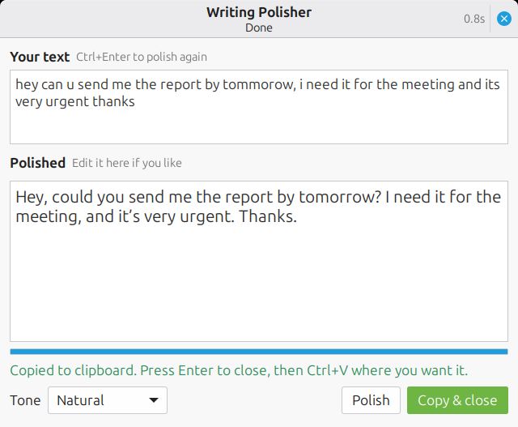
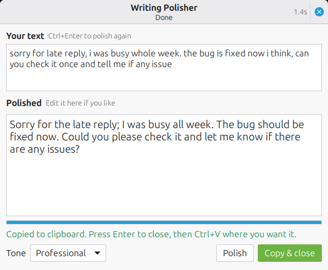

# TextPolish

Write rough, get back clear, correct, human-sounding text. Highlight text in any app, press **Ctrl+Alt+P**, and a small window shows the polished version as it is written. The result is copied to your clipboard automatically.

Uses Groq's free API tier. You bring your own Groq API key.

> **Linux only (for now).** TextPolish is built and tested on Linux Mint (Cinnamon, X11). It should work on most X11 desktops with GTK 3. Wayland, macOS and Windows are not supported yet. Pull requests that add support are welcome.

## Requirements
- Linux with an X11 session
- Python 3 with GTK 3 bindings (PyGObject). Preinstalled on Linux Mint and most GNOME/Cinnamon desktops.
- `xclip` (`sudo apt install xclip`)
- Node.js (tested on v22) and npm, for the `polish` command
- A free Groq API key from https://console.groq.com/keys

## Install
    git clone https://github.com/shahidiqbal407/textpolish.git ~/textpolish
    cd ~/textpolish && npm install
    mkdir -p ~/.local/bin
    printf '#!/bin/sh\nexec "%s" "%s/polish.mjs" "$@"\n' "$(which node)" "$PWD" > ~/.local/bin/polish && chmod +x ~/.local/bin/polish
    polish set-key        # paste your Groq API key (saved to ~/.config/textpolish/api_key)

Then add a keyboard shortcut. On Cinnamon: **System Settings → Keyboard → Shortcuts → Custom Shortcuts**.
Command: `/usr/bin/python3 ~/textpolish/polisher_app.py`, keys: **Ctrl+Alt+P**.
Other desktops have a similar custom-shortcut setting.

## Use it
- **Anywhere (hotkey):** highlight text in any app, press **Ctrl+Alt+P**. Press Enter to close the window, then Ctrl+V.
- **Desktop app:** run `polisher_app.py --new` to type text in directly. `polish serve` opens a browser version.
- **Terminal:** `polish "your text"`, `polish --tone firm "..."`, or `echo text | polish`

Tones: natural, professional, friendly, firm, concise, grammar.

## Examples

**Desktop app** (natural tone):

**Professional tone:**

**Terminal:**

    $ polish "i has finish the task yesterday but forgot to update you, sorry about that"
    I finished the task yesterday but forgot to let you know—sorry about that.

    $ polish --tone firm "can you please maybe try to send the invoice soon if possible, its been two weeks"
    Could you please send the invoice as soon as possible? It’s been two weeks.

## Settings
- `settings.json`: the model and the default tone.
- `prompts.json`: the writing rules and the tones.
- Environment variables `POLISH_MODEL`, `POLISH_TONE` and `GROQ_API_KEY` override the files.

Groq free-tier limits change over time. Check https://console.groq.com/settings/limits for the current numbers.

## Privacy
Your text is sent to Groq's API to be rewritten. Your API key stays on your machine in `~/.config/textpolish/api_key`.

## Contributing
TextPolish is open source and contributions are welcome.

1. Fork the repo and create a branch.
2. Make your change, and test it on Linux.
3. Open a pull request that explains what it changes and why.

All pull requests are reviewed, and only the maintainer can merge. Bug reports and ideas are welcome in Issues.

## License
MIT. See [LICENSE](LICENSE).
